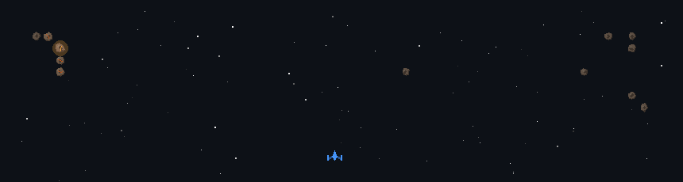

<!-- ===================== ENCABEZADO ===================== -->
<p align="center">
  
</p>

<p align="center">
  <a href="https://github.com/Jlroja">
    
  </a>
</p>

<p align="center">
  <a href="https://linkedin.com/in/javierlasso"></a>
  <a href="mailto:jalasso2017@gmail.com"></a>
  
</p>

---

## 🛸 Sobre mí

```yaml
piloto:    Javier Andrés Lasso Rojas
base:      Colombia 🇨🇴
academia:  Ingeniería de Sistemas — Universidad del Valle
mision:    Construir software útil y modelos de IA que resuelvan problemas reales
radar:     [Machine Learning, Visión por Computador, Data Engineering, Desarrollo Web]
estado:    🟢 Abierto a oportunidades en desarrollo de software y datos
```

---

## 🧰 Arsenal tecnológico

<p align="center">
  <br/>
  <br/>
  <br/>
  
</p>

---

## 📡 Panel de control

<p align="center">
  
  
</p>

<p align="center">
  
</p>

<p align="center">
  
</p>

---

## 🚀 Batalla espacial de contribuciones

> Cada cuadrito de mi gráfica de contribuciones es un enemigo. La nave los destruye uno a uno. Se actualiza solo todos los días con GitHub Actions.

<p align="center">
  
</p>

---

## 🪐 Proyectos destacados

<table>
  <tr>
    <td width="50%" valign="top">
      <h3>🛍️ <a href="https://github.com/DylanFarkas/moda-chic-frontend">Moda Chic — eCommerce</a></h3>
      <p>Tienda virtual con login, carrito de compras y panel de administrador.</p>
      <p><b>Rol:</b> Desarrollo frontend y conexión con el backend.</p>
      <p>
        
        
        
        
        
      </p>
    </td>
    <td width="50%" valign="top">
      <h3>🎮 <a href="https://github.com/Jlroja/yoshizone">Yoshi's Zones — IA con Minimax</a></h3>
      <p>Juego de estrategia donde la computadora decide sus jugadas con el algoritmo Minimax.</p>
      <p><b>Rol:</b> Motor del juego y lógica de la IA.</p>
      <p>
        
        
      </p>
    </td>
  </tr>
  <tr>
    <td width="50%" valign="top">
      <h3>🕹️ <a href="https://github.com/Jlroja/Mini-Juego-3D">Mini Juego 3D</a></h3>
      <p>Videojuego 3D desarrollado en Unity.</p>
      <p>
        
        
      </p>
    </td>
    <td width="50%" valign="top">
      <h3>🔄 <a href="https://github.com/Jlroja/ProyectoETL">Proyecto ETL</a></h3>
      <p>Pipeline de extracción, transformación y carga de datos.</p>
      <p>
        
        
      </p>
    </td>
  </tr>
</table>

---

<p align="center">
  <i>"Siempre estoy dispuesto a aprender y participar en nuevos proyectos."</i> 🌌
</p>

<!-- ===================== PIE ===================== -->
<p align="center">
   
</p>
